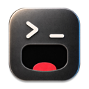
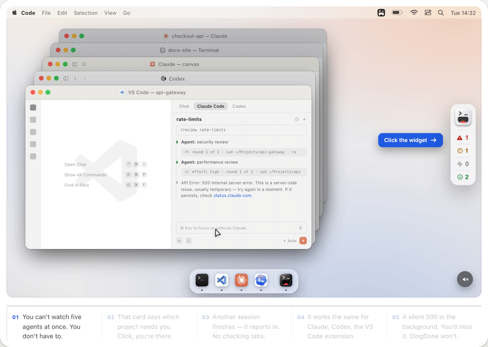
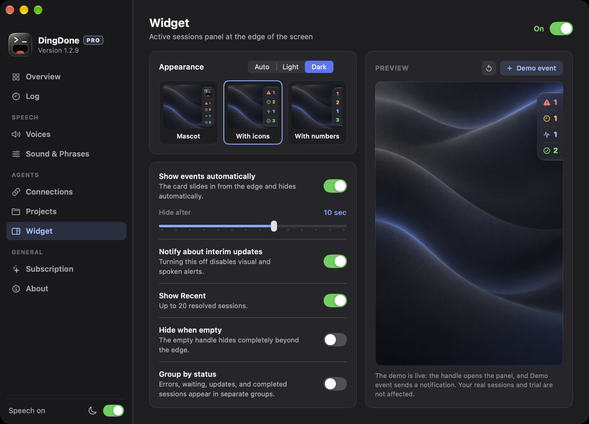
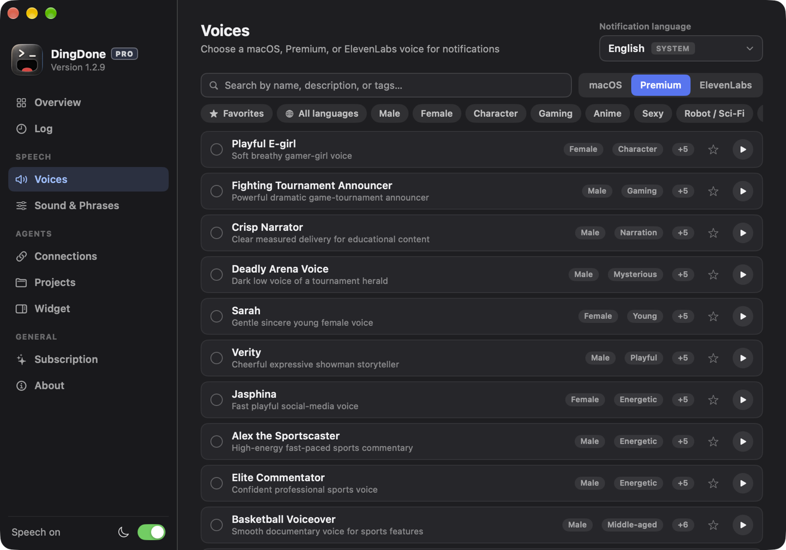
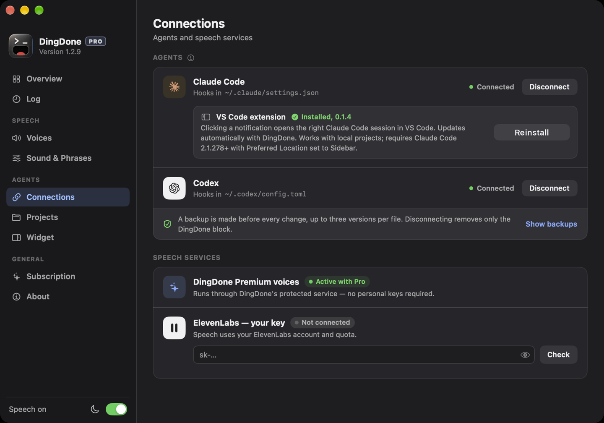

  

<h1 align="center">DingDone</h1>

  <b>Voice notifications for Claude Code and Codex on macOS.</b> 
  Start a long task, walk away, and hear when your coding agent needs you.

  <a href="https://github.com/makeaiwork/dingdone-releases/releases/latest/download/DingDone.dmg"><b>Download for Mac</b></a>
  &nbsp;·&nbsp;
  <a href="https://dingdone.io">Website</a>
  &nbsp;·&nbsp;
  <a href="https://github.com/makeaiwork/dingdone-releases/releases">Release notes</a>
  &nbsp;·&nbsp;
  <a href="PRIVACY.md">Privacy</a>

  Apple silicon · macOS 13 or newer · signed and notarized by Apple · free, no account

  <picture>
    <source media="(prefers-color-scheme: dark)" srcset="screenshots/hero-dark.gif">
    <source media="(prefers-color-scheme: light)" srcset="screenshots/hero.gif">
    
  </picture>

---

> **"Claude Code, Atlas, finished working."**
> **"Codex, Photon, is waiting for a response."**

DingDone is a small menu-bar app. When Claude Code or Codex finishes a task, asks a question,
needs a permission or stops with an error, DingDone plays a short chime and says which agent it
was, in which project, and what happened. You can stop watching the spinner and come back only
when something meaningful changes.

## What it does

- **Tells you who, where and what.** Every alert is built as *chime → agent name → project →
  event*, so you know what needs attention before you look at the screen.
- **Five meaningful events, nothing else.** Completion, waiting for your response, a reminder if
  you still haven't answered, an interim update from long background work, and errors. Routine
  tool calls, plan steps and dev servers left running in the background stay quiet.
- **Works where you already work.** Claude Code and Codex in the terminal or in VS Code. DingDone
  listens to the agents' own hook events. It does not watch your screen.
- **Speaks offline.** The free version uses the Apple voices already on your Mac. Notifications
  are available in 14 languages, and every phrase can be edited.
- **Names your projects properly.** The spoken name comes from the folder, with numeric prefixes
  like `42.` removed. You can set any name in the app.
- **Keeps a log.** See what was said and when, filter by agent or errors, and replay any alert.

## A closer look

**Overview.** Today at a glance: finished tasks, how often and how long agents waited for you,
errors, and which projects were busiest.

**Widget.** A slim panel at the edge of the screen shows active sessions by status. A card slides
out when something happens and hides on its own. Choose a mascot, icons or plain numbers.

**Voices.** Use any macOS voice for free, or pick from the Premium library: narrators,
announcers, calm and energetic voices in many languages. You can also bring your own ElevenLabs key.

**Connections.** One click adds DingDone's hooks to Claude Code and Codex. The VS Code extension
lets a notification open the exact Claude Code session.

**Sound & Phrases.** Pick a chime and a phrase for each event, set the speech rate and volume,
and choose how long DingDone waits before reminding you that an agent is still waiting.

Screenshots use demo projects.

## Get started

1. [Download `DingDone.dmg`](https://github.com/makeaiwork/dingdone-releases/releases/latest/download/DingDone.dmg)
   and drag DingDone to Applications.
2. Launch DingDone and pick a language and voice.
3. Open **Connections** and click **Connect** for Claude Code and/or Codex.
4. Restart your agent session so it picks up the new hooks.
5. Press **Test sound**. Setup usually takes about three minutes.

Connecting adds a clearly marked DingDone block to `~/.claude/settings.json` or
`~/.codex/config.toml`. DingDone backs up each file before changing it and keeps up to three
copies. Disconnecting removes only the DingDone block.

DingDone updates itself through a signed update feed. You can also check manually from the menu
bar.

## Free and Pro

Everything described above is free, with no time limit and no account: the voice notifications,
the widget with your active sessions, and the jump to the exact session.

Pro is optional and adds **more voices**: the Premium voice library, or your own ElevenLabs key.
You can try Pro free for 14 days inside the app, with no card and no account.

## Privacy

- DingDone receives only the event type, the project folder and the session ID from the agent.
  It never reads or logs your prompts, your code or the agent's replies.
- Apple voices run entirely on your Mac.
- The local log keeps only the event type, the folder and the phrase that was spoken.
- Premium voices receive only the short notification phrase.

Read the full [privacy policy](PRIVACY.md).

## Support

Questions and bug reports: [support@dingdone.io](mailto:support@dingdone.io).

---

This repository hosts DingDone's signed release builds (see
[Releases](https://github.com/makeaiwork/dingdone-releases/releases)) and the Sparkle update
feed `appcast.xml` used by the app. The source code is not published here.
